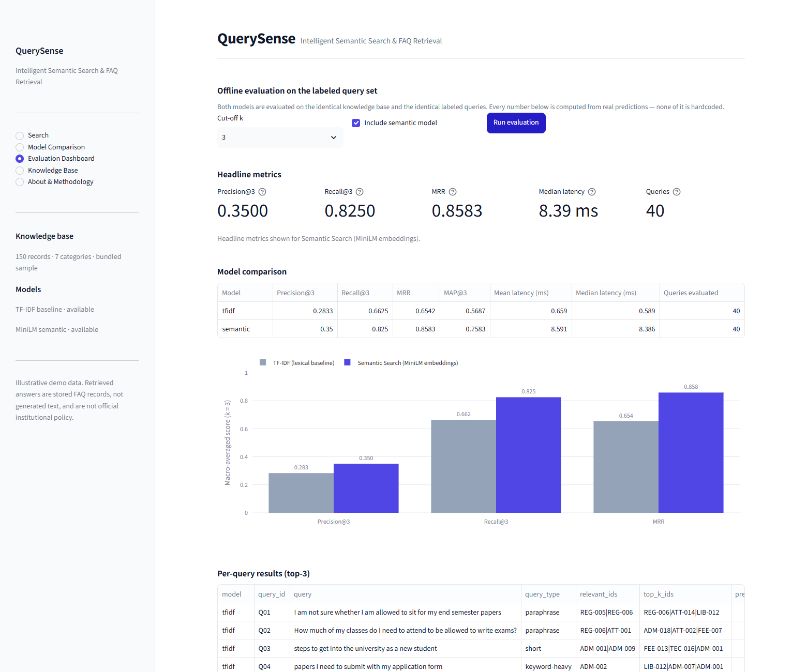

# QuerySense — Intelligent Semantic Search & FAQ Retrieval System

An end-to-end NLP information-retrieval project that answers natural-language questions by
ranking and returning the most relevant records from a structured FAQ knowledge base. It
implements and empirically compares two retrieval strategies:

1. **Baseline** — TF-IDF vectorization with cosine similarity (lexical matching).
2. **Semantic retrieval** — Sentence Transformers (`sentence-transformers/all-MiniLM-L6-v2`)
   with cosine similarity over dense embeddings.

Both models are evaluated on the same held-out, hand-labeled query set so the comparison is
fair and reproducible.

> **What this is not.** QuerySense is a retrieval system, not a generative chatbot. Every
> answer shown is a stored FAQ record retrieved verbatim. Nothing is generated by a language
> model, and no similarity score is presented as a probability or a confidence percentage.

---

## Table of contents

- [Student details](#student-details)
- [Problem statement](#problem-statement)
- [Objectives](#objectives)
- [Features](#features)
- [Architecture and pipeline](#architecture-and-pipeline)
- [Dataset](#dataset)
- [Installation](#installation)
- [Running the project](#running-the-project)
- [Models](#models)
- [Evaluation methodology](#evaluation-methodology)
- [Results](#results)
- [Qualitative analysis](#qualitative-analysis)
- [Screenshots](#screenshots)
- [Testing](#testing)
- [Limitations](#limitations)
- [Future work](#future-work)
- [Troubleshooting](#troubleshooting)
- [GitHub workflow](#github-workflow)
- [License and acknowledgements](#license-and-acknowledgements)

---

## Student details

> **ACTION REQUIRED — replace every placeholder below before submission.**
> No personal information has been invented or guessed.

| Field | Value |
|---|---|
| **Student name** | `<YOUR FULL NAME>` |
| **Registration number** | `MUJ-DS-2430010346` |
| **Branch** | `<YOUR BRANCH, e.g. Computer Science & Engineering (Data Science)>` |
| **Batch** | `Batch F` |
| **GitHub username** | `arjunnain17` |
| **Repository** | https://github.com/arjunnain17/MUJ-DS-2430010346 |
| **Training program** | `<PROGRAM NAME, e.g. Data Science & Machine Learning Capstone>` |
| **Program duration / cohort** | `<e.g. Month Year – Month Year>` |
| **Mentor / evaluator** | `<NAME>` |

---

## Problem statement

Institutional knowledge is published as a fixed list of frequently asked questions. Students
rarely reuse the wording of those questions: they ask *"money back if I leave the course before
it starts"* when the FAQ says *"What is the refund policy if I withdraw my admission before
classes start?"*.

Keyword search fails on exactly this gap. It scores documents by shared words, so a paraphrase
that shares no vocabulary returns nothing useful, while a query sharing one polysemous word
("leave") returns confidently wrong results.

**QuerySense measures that gap.** It runs a lexical baseline and a semantic retriever over the
same knowledge base and the same labeled queries, and reports the difference in retrieval
quality and latency.

---

## Objectives

1. Build a validated, self-contained FAQ knowledge base that requires no manual download.
2. Implement a reproducible TF-IDF + cosine similarity baseline.
3. Implement semantic retrieval with pretrained `all-MiniLM-L6-v2` sentence embeddings on CPU.
4. Evaluate both models on an identical, independently labeled query set using Precision@k,
   Recall@k, MRR and query latency.
5. Quantify where semantic retrieval beats literal keyword matching — and where it also fails.
6. Deliver a polished, usable interface and a fully reproducible pipeline (tests + CLI + UI).

---

## Features

**Search**
- Natural-language query box with Enter-to-submit and selectable example questions.
- Model selector (TF-IDF or Semantic), top-k selector (1–10, default 3) and an optional
  minimum-similarity threshold.
- Ranked answer cards showing rank, question, category, source id and model-specific score,
  each expandable to the full retrieved answer and metadata.
- Explicit no-match and weak-match states that recommend a more specific query instead of
  presenting an unreliable result.
- Session search history.

**Model comparison**
- The same query through both models side by side.
- Rank-change table (TF-IDF rank vs semantic rank), shared vs model-specific results, and an
  explanation of why raw scores are not comparable across models.

**Evaluation dashboard**
- Precision@k, Recall@k, MRR, MAP@k, mean/median/p95 latency and query count.
- Grouped Plotly bar chart, full per-query table with CSV export, and correctly-retrieved vs
  missed examples.
- Explicit notice when no evaluation has been run or a model is unavailable.

**Knowledge base**
- Record and category counts, category distribution chart, searchable/filterable table,
  record inspection, and the indexed search text for each record.
- Validated CSV upload held in session state — it **never overwrites the bundled sample data on
  disk** — plus a restore-sample action and a dataset download.

**Engineering**
- Indexes, embeddings and the evaluation result are cached and keyed by a knowledge-base
  fingerprint, so they rebuild only when the underlying records change.
- Graceful degradation: if the embedding model cannot be loaded, semantic mode is disabled with
  a clear reason and TF-IDF continues to work.

---

## Architecture and pipeline

```
                 ┌──────────────────────────────┐
                 │  data/faqs.csv (150 records) │
                 └───────────────┬──────────────┘
                                 │
                    ┌────────────▼─────────────┐
                    │ src/data_loader.py       │  schema validation,
                    │ src/preprocessing.py     │  whitespace/id cleanup,
                    └────────────┬─────────────┘  searchable-text build
                                 │
              question + keywords + category (answers excluded from indexing)
                                 │
        ┌────────────────────────┴────────────────────────┐
        │                                                 │
┌───────▼─────────────────┐                  ┌────────────▼──────────────────┐
│ src/tfidf_retriever.py  │                  │ src/semantic_retriever.py     │
│ TfidfVectorizer (1-2g)  │                  │ all-MiniLM-L6-v2, 384-d       │
│ L2-normalized sparse    │                  │ L2-normalized dense, CPU      │
└───────┬─────────────────┘                  └────────────┬──────────────────┘
        │        cosine similarity (= dot product)          │
        └────────────────────────┬─────────────────────────┘
                                 │
                    ┌────────────▼─────────────┐
                    │ src/base_retriever.py    │  top-k, deterministic
                    │ Deterministic ranking    │  ranking, thresholding
                    └────────────┬─────────────┘
                                 │
        ┌────────────────────────┴────────────────────────┐
        │                                                 │
┌───────▼──────────────────┐               ┌──────────────▼─────────────────┐
│ app.py (Streamlit UI)    │               │ src/evaluation.py + metrics.py │
│ 5 pages, cached indexes  │               │ P@k, R@k, MRR, MAP, latency    │
└──────────────────────────┘               └──────────────┬─────────────────┘
                                                          │
                                            results/metrics.json
                                            results/evaluation_results.csv
                                            results/qualitative_examples.csv
```

### Repository layout

```
QuerySense/
├── app.py                      # Streamlit interface (5 pages)
├── requirements.txt
├── README.md
├── LICENSE
├── .gitignore
├── pytest.ini
├── .streamlit/
│   └── config.toml             # pinned light theme
├── data/
│   ├── faqs.csv                # 150 illustrative FAQ records
│   └── evaluation_queries.csv  # 40 labeled evaluation queries
├── src/
│   ├── __init__.py
│   ├── base_retriever.py       # shared retriever contract + RetrievalHit
│   ├── data_loader.py          # loading, validation, fingerprinting
│   ├── preprocessing.py        # normalization + searchable-text construction
│   ├── tfidf_retriever.py      # lexical baseline
│   ├── semantic_retriever.py   # MiniLM dense retrieval
│   ├── metrics.py              # ranking metrics (pure functions)
│   └── evaluation.py           # evaluation pipeline + artifact writing
├── tests/
│   ├── conftest.py             # offline fake encoder + fixtures
│   ├── test_data_loader.py     # 38 tests
│   ├── test_evaluation.py      # 16 tests
│   ├── test_metrics.py         # 25 tests
│   └── test_retrieval.py       # 35 tests
├── notebooks/
│   └── experiments.ipynb       # end-to-end reproducible walkthrough
├── results/
│   ├── metrics.json            # generated by src/evaluation.py
│   ├── evaluation_results.csv
│   └── qualitative_examples.csv
├── screenshots/                # real captures of the running app
├── presentations/
│   └── presentation_outline.md # 5–7 minute demo script
└── capstone/
    └── project_summary.md
```

---

## Dataset

### `data/faqs.csv` — 150 FAQ records

| Category | Records |
|---|---|
| Fees, Scholarships & Administration | 24 |
| Hostel & Campus Facilities | 22 |
| Registration & Examinations | 22 |
| Student Technical Support | 22 |
| Admissions & Enrollment | 20 |
| Attendance & Academic Policy | 20 |
| Library & Learning Resources | 20 |
| **Total** | **150** |

Each record has `id`, `category`, `question`, `answer`, `keywords` and `source`.

> **Provenance and honesty note.** This is **synthetic, illustrative demonstration data**
> written for this capstone. It is deliberately generic institutional content and **does not
> describe the official policies of Manipal University Jaipur or any other real institution.**
> No claim of official status is made anywhere in the application or this document.

No public dataset was substituted. Datasets such as MS MARCO or Natural Questions were
considered, but adopting one would have required distributing multi-gigabyte corpora and
redesigning the task around their format within the project budget, and their relevance labels
do not map onto a curated FAQ knowledge base. The bundled synthetic set keeps the project
self-contained, instantly reproducible and free of licensing ambiguity. Provenance for the
synthetic data is recorded in `results/metrics.json` under `knowledge_base` (record count,
category count and a content fingerprint).

### `data/evaluation_queries.csv` — 40 labeled queries

| Query type | Count | Example |
|---|---|---|
| `paraphrase` | 22 | "I am not sure whether I am allowed to sit for my end semester papers" |
| `combined` | 9 | "money back if I leave the course before it starts" |
| `keyword-heavy` | 5 | "electric kettle in my hostel room is it allowed" |
| `short` | 4 | "exam admit card download" |

Each query has `query_id`, `query`, `relevant_ids` (pipe-separated FAQ ids) and `query_type`.
Labels were assigned by hand against the FAQ set and are independent of any model prediction.
A test (`test_no_query_is_identical_to_a_faq_question`) enforces that no evaluation query simply
repeats a FAQ's exact wording.

---

## Installation

Requires **Python 3.10+** (developed and tested on Python 3.13, CPU only — no GPU needed).

```bash
git clone https://github.com/arjunnain17/MUJ-DS-2430010346.git
cd MUJ-DS-2430010346/QuerySense

python -m venv .venv

# Windows
.venv\Scripts\activate
# macOS / Linux
source .venv/bin/activate

pip install -r requirements.txt
```

The first semantic run downloads `all-MiniLM-L6-v2` (~90 MB) from Hugging Face and caches it
locally. This is a one-time cost; later runs load from cache in a few seconds.

---

## Running the project

```bash
# 1. Launch the interface
streamlit run app.py
#    → http://localhost:8501

# 2. Run the automated test suite (no network required)
python -m pytest -q

# 3. Reproduce the evaluation and regenerate results/
python -m src.evaluation --k 3

#    TF-IDF baseline only (skips the model download entirely)
python -m src.evaluation --k 3 --no-semantic
```

---

## Models

### Baseline — TF-IDF with cosine similarity

- `sklearn.feature_extraction.text.TfidfVectorizer`
- 1–2 grams, sublinear TF scaling, English stop words, unicode accent stripping,
  `max_features=20000`, fitted `min_df` clamped to the corpus size.
- sklearn L2-normalizes each row, so the dot product **is** the cosine similarity.
- Indexed vocabulary: **2,144 terms.** Index build: **0.03 s.**

**Why it misses paraphrases.** The representation is a sparse count vector over surface
n-grams. A document and a query that share no terms have a cosine similarity of exactly zero,
regardless of meaning. "Leave" in a refund question and "leave" in a leave-of-absence FAQ are
the same token to this model.

### Semantic — `sentence-transformers/all-MiniLM-L6-v2`

- 6-layer MiniLM transformer, **384-dimensional** sentence embeddings, CPU inference.
- Embeddings are L2-normalized (`normalize_embeddings=True`) so cosine similarity is again a
  dot product, making the two models mechanically comparable even though their scores are not.
- Pretrained and used as-is: **no fine-tuning or training from scratch.**
- Model load (cached): **10.44 s.** Embedding build for 150 records: **0.70 s.**

**Why it captures paraphrases.** The encoder maps whole sentences into a continuous space where
semantic similarity is geometric proximity. Because it was trained on sentence pairs, paraphrases
that share no vocabulary still land close together, so retrieval no longer depends on matching
words.

Both models rank the *questions* (plus keywords and category). Answers are attached as retrieved
content but deliberately excluded from the index, so a long answer cannot dominate the score.

---

## Evaluation methodology

- **Identical inputs.** Both models run over the same 150-record knowledge base and the same 40
  labeled queries. Query ordering is identical.
- **Definitions.** With `R` = relevant records retrieved in the top k:
  - **Precision@k** = `|R| / k` — the denominator is always `k`, so a query with no relevant
    result scores 0 rather than being undefined.
  - **Recall@k** = `|R| / (total relevant labeled for the query)`.
  - **MRR** = mean over queries of `1 / rank` of the first relevant result, or 0 when none is
    retrieved.
  - **MAP@k** and **hit rate@k** are also reported.
- **Macro-averaging.** Ranking metrics are averaged over queries; the number of evaluated
  queries is always reported alongside them.
- **Latency.** Measured with `time.perf_counter()` per query, in milliseconds. Model loading and
  index construction are timed **separately** and excluded from query latency. A warm-up pass
  runs every query once (untimed) before the timed pass, so reported latency is steady-state.
- **No tuning on the test set.** No threshold, model or parameter was selected using these
  results. The evaluation set is used once, for reporting only.
- **No hardcoded numbers.** Every value in `results/` is computed from model predictions and
  ground-truth labels. If the semantic model cannot be downloaded, semantic results are recorded
  as `"available": false` with the failure reason — they are never estimated or invented.

**Note on the Precision@k values.** Many queries have only one or two relevant FAQ records. With
k = 3, a perfect single-relevant retrieval scores at most 0.333, which caps Precision@3 well
below 1.0 by construction. Recall@3 and MRR are the more informative metrics on this query set.

---

## Results

Environment: Python 3.13.14 · Windows 11 (10.0.26200) · CPU inference · k = 3 · 150 records ·
40 labeled queries. Full machine-readable output: [`results/metrics.json`](results/metrics.json).

### Headline comparison

| Model | Precision@3 | Recall@3 | MRR | MAP@3 | Hit rate@3 | Mean latency | Median latency | Queries |
|---|---|---|---|---|---|---|---|---|
| **TF-IDF (baseline)** | 0.2833 | 0.6625 | 0.6542 | 0.5687 | 0.7750 | 0.82 ms | 0.80 ms | 40 |
| **Semantic (MiniLM)** | **0.3500** | **0.8250** | **0.8583** | **0.7583** | **0.9250** | 11.06 ms | 10.94 ms | 40 |
| **Difference** | +0.0667 | +0.1625 | +0.2042 | +0.1896 | +0.1500 | +10.24 ms | +10.14 ms | — |

**Setup cost (excluded from query latency)**

| Model | Model load | Index / embedding build |
|---|---|---|
| TF-IDF | 0.00 s | 0.03 s |
| Semantic | 10.09 s (cached after first download) | 0.73 s |

**Queries with no relevant record retrieved in the top 3:** TF-IDF **9 / 40**, semantic **3 / 40**.

> **Reproducibility note on latency.** The ranking metrics above are **exactly reproducible** —
> they are deterministic functions of the predictions and labels. Query latency is **not**: across
> three runs of `python -m src.evaluation --k 3` on the same machine, TF-IDF median latency moved
> between 0.66 ms and 1.02 ms, and semantic median latency between 9.57 ms and 11.11 ms. The
> values quoted here are those in the committed [`results/metrics.json`](results/metrics.json);
> treat that file as the source of truth and expect latency to shift between runs and machines.

### What the numbers mean

- Semantic retrieval improves **MRR by 0.2042 (≈ 31 % relative)** and **Recall@3 by 0.1625
  (≈ 25 % relative)** over the lexical baseline.
- It fails to retrieve anything relevant on only 3 of 40 queries versus 9 for TF-IDF.
- The improvement is not free: semantic retrieval costs roughly **an order of magnitude more
  latency** (10.94 ms vs 0.80 ms median in the committed run; ~10–14× across repeated runs), plus
  a one-time ~10 s model load. For this corpus both are far below any human-perceptible threshold,
  so the quality gain dominates — but the trade-off is real and would matter at much larger scale.
- Recall@3 of 0.8250 means the semantic model still misses about 17.5 % of the labeled relevant
  records within the top 3.

### Metric chart



### Qualitative case distribution

| Case | Queries |
|---|---|
| Both models succeed, same first relevant rank | 19 |
| Both models succeed, ranking differs | 11 |
| **Only semantic retrieval succeeds** | **7** |
| Only TF-IDF succeeds | 1 |
| Both models fail | 2 |

---

## Qualitative analysis

Five illustrative cases from `results/qualitative_examples.csv`.

### 1. Paraphrase failure and recovery — where semantic retrieval wins

**Q13 — "money back if I leave the course before it starts"**
Relevant: `ADM-018` (refund policy on withdrawal before classes start), `FEE-015`.

| | Top 3 retrieved | First relevant rank |
|---|---|---|
| TF-IDF | `ATT-005` "…inform the department before taking leave?", `ATT-011` "medical leave certificate", `ATT-006` "leave of absence" | **none** (RR = 0.0) |
| Semantic | `ADM-018` ✅, `REG-022`, `REG-003` | **1** (RR = 1.0) |

TF-IDF anchors on the single token **"leave"** and returns three attendance-policy FAQs, none
of which answers the question — a confident, entirely wrong answer set. The semantic model
retrieves the actual refund policy at rank 1. This is the clearest single illustration of the
project's thesis.

### 2. Short, telegraphic query — both models succeed, rankings differ

**Q19 — "i failed a subject what do i do next"**
Relevant: `REG-009` (supplementary exam), `REG-014` (backlog vs arrear).

- TF-IDF rank 1: `REG-014` ✅ (the vocabulary "failed subject" appears directly).
- Semantic rank 1: `REG-022` (late course withdrawal) ❌, with the relevant records lower.

Here the lexical model wins: the query reuses the FAQ's own words, so exact-term matching is
competitive. This is the honest counter-case — semantic retrieval is not universally better.

### 3. Lexical compatibility trap — semantic wins

**Q09 — "electric kettle in my hostel room is it allowed"**
Relevant: `HOS-012` (prohibited electrical appliances).

- TF-IDF: `HOS-006` (maintenance), `HOS-003` (room allotment), `HOS-002` (hostel fees) — all
  topically about hostels, none relevant.
- Semantic: `HOS-012` ✅ at rank 1.

Matching "hostel room" is enough for TF-IDF to return plausible-looking but wrong records;
embeddings capture *prohibited appliance* as the actual intent.

### 4. Paraphrase with zero shared vocabulary — semantic wins

**Q28 — "installment option for paying admission charges"**
Relevant: `FEE-005` (paying fees in instalments).

- TF-IDF: `ADM-017`, `HOS-002`, `ADM-001` — misses entirely.
- Semantic: `FEE-005` ✅ at rank 1.

Neither "installment" nor "charges" appears in the target FAQ ("Can I pay the fees in
instalments?"); only the embedding space bridges the wording difference.

### 5. Honest failure — both models fail

**Q25 — "can I stay somewhere on campus instead of travelling daily"**
Relevant: `HOS-001` (hostel accommodation), `HOS-002` (hostel fees).

- TF-IDF: `HOS-005` (guests), `HOS-017` (shuttle), `HOS-018` (ATMs) — no relevant record.
- Semantic: `HOS-005`, `HOS-017`, `HOS-021` — also no relevant record.

The intent ("I want accommodation") is expressed through a situation rather than the domain
vocabulary, and the FAQ set has no record phrased around "staying on campus". This is a
**label and data-coverage limitation**, not purely a model failure, and it is reported rather
than hidden.

Similarly **Q20 — "how many days can I keep a library book"** (relevant `LIB-003`) is missed by
both: the target asks about the "loan period", semantic retrieval returns `LIB-002` (how many
books) at rank 3 and the others return reservations and lost-book policies.

---

## Screenshots

Real captures of the running application (Chromium via `agent-browser`, 1560×1300 viewport).

| # | Screenshot | Shows |
|---|---|---|
| 1 | [`01-search-page.png`](screenshots/01-search-page.png) | Search page: query box, model selector, top-k, threshold, example chips |
| 2 | [`02-search-results-semantic.png`](screenshots/02-search-results-semantic.png) | Ranked answer cards with scores, category, source and expanded answer |
| 3 | [`03-model-comparison.png`](screenshots/03-model-comparison.png) | Same query through both models side by side |
| 4 | [`04-evaluation-dashboard.png`](screenshots/04-evaluation-dashboard.png) | Headline metrics, comparison table and metric chart |
| 5 | [`05-knowledge-base.png`](screenshots/05-knowledge-base.png) | Record/category counts, category distribution and browsable table |
| 6 | [`06-about-methodology.png`](screenshots/06-about-methodology.png) | About & methodology, including reproduction commands |
| 7 | [`07-comparison-rank-changes.png`](screenshots/07-comparison-rank-changes.png) | Rank-change table and shared vs model-specific results |
| 8 | [`08-evaluation-per-query.png`](screenshots/08-evaluation-per-query.png) | Per-query evaluation table |
| 9 | [`09-knowledge-base-upload.png`](screenshots/09-knowledge-base-upload.png) | Validated CSV upload and restore-sample controls |

---

## Testing

**114 tests, all passing, fully offline** — the semantic tests inject a deterministic fake
hashing encoder, so no model download and no network access is required.

```bash
python -m pytest -q          # 114 passed
```

| File | Tests | Covers |
|---|---|---|
| `tests/test_data_loader.py` | 38 | Schema validation, missing/duplicate ids, empty and malformed datasets, CSV upload rejection, safe defaults, fingerprint stability, bundled data integrity, "upload never mutates the sample data" |
| `tests/test_retrieval.py` | 35 | k-clamping, result shape, score ranges, deterministic ranking, empty queries, zero-overlap queries, threshold filtering, shared doc ids across both retrievers, model-download failure handling |
| `tests/test_metrics.py` | 25 | Precision@k / Recall@k / MRR / MAP against hand-computed values, no-relevant-result cases, k-denominator behaviour, latency summaries |
| `tests/test_evaluation.py` | 16 | Metrics derived from a scripted retriever's own predictions, identical queries across models, unavailable-model reporting, artifact writing, qualitative case classification |

### Interface smoke test

The Streamlit app was launched and driven through a real browser. Verified by direct
interaction, not assumed:

- ✅ App launches, `/_stcore/health` returns `200 ok`.
- ✅ All five pages render (Search, Model Comparison, Evaluation Dashboard, Knowledge Base, About).
- ✅ Search returns ranked results for both models; example chips trigger retrieval.
- ✅ Expanders open to reveal the full retrieved answer and metadata.
- ✅ Model Comparison renders both models, shared/model-specific result sets and the rank table.
- ✅ Evaluation Dashboard computes and renders live metrics, chart and tables (verified values
  match `results/metrics.json`).
- ✅ Knowledge Base renders counts, the category chart and the browsable table.
- ⚠️ The CSV upload control was **not** exercised end-to-end through the browser (no file was
  uploaded in the UI session). The upload path itself is covered by 7 automated tests in
  `test_data_loader.py`, including rejection cases. This is stated rather than claimed as a
  passing browser test.

One interface defect was found and fixed during this verification: the app initially inherited
Streamlit's dark theme from the host's OS preference while its stylesheet assumed a light
background, producing unreadable low-contrast headings. The theme is now pinned explicitly in
`.streamlit/config.toml`.

---

## Limitations

1. **Small, synthetic corpus.** 150 records across 7 categories. Absolute metric values are
   indicative of the models' *relative* behaviour, not production performance.
2. **Single-annotator relevance labels.** Ground truth was labeled by one person. Ambiguous
   queries would likely reveal label disagreement with a second annotator.
3. **Similarity ≠ correctness.** Cosine similarity measures how close two texts are, not whether
   the retrieved answer actually resolves the user's problem. The top result can be topically
   adjacent yet not answer the question.
4. **Ambiguous and under-specified queries.** Some queries legitimately span multiple records
   (e.g. `HOS-001` + `HOS-002`), so part of the measured error is label design rather than model
   weakness.
5. **No score calibration.** Scores come from two different geometries. They are reported as
   model-specific similarity values and are deliberately *not* compared across models.
6. **Latency asymmetry.** Semantic retrieval is roughly an order of magnitude slower per query
   (~11 ms vs ~0.8 ms median) and needs a ~10 s one-time model load. Latency is also the only
   metric that is not perfectly reproducible run to run. At millions of records a brute-force
   NumPy dot product would need a proper vector index (FAISS, hnswlib) instead.
7. **English-only, no domain adaptation.** The model is used pretrained; it has no institutional
   fine-tuning and no multilingual support.
8. **Interface-internal findings.** Full-page screenshots capture the viewport, because
   Streamlit scrolls an inner container; very long pages were captured section by section.

---

## Future work

- Grow the corpus to 1,000+ records and add a second annotator to measure label agreement
  (e.g. Cohen's kappa).
- Add a hybrid retriever (reciprocal rank fusion of TF-IDF and embeddings) and evaluate it as a
  third arm — it often outperforms either alone.
- Replace brute-force similarity with FAISS/HNSW and re-measure latency at scale.
- Add cross-encoder reranking of the top 20 candidates as a precision-boosting stage.
- Introduce an explicit "no good answer" classifier instead of a fixed similarity threshold.
- Publish a small human-evaluated answer-correctness study, distinct from ranking metrics.

---

## Troubleshooting

| Problem | Cause | Fix |
|---|---|---|
| `Semantic search is unavailable` in the sidebar | `sentence-transformers` not installed, or the model could not be downloaded (no network / blocked Hugging Face endpoint) | Install it with `pip install sentence-transformers`; if the network is restricted, pre-download `all-MiniLM-L6-v2` and set `HF_HOME`. TF-IDF keeps working regardless. Alternatively run `python -m src.evaluation --no-semantic`. |
| First semantic query takes ~10–30 s | The ~90 MB model weights are downloading once | One-time cost; subsequent runs load from the local cache. The app caches the model with `st.cache_resource`. |
| `ModuleNotFoundError: No module named 'src'` | Running Python/pytest from outside the project root | `cd QuerySense` first. `pytest.ini` sets `pythonpath = .` for the test suite. |
| `torch` install fails or is very large | PyTorch wheels are platform-specific and may lag the newest Python releases | Use Python 3.10–3.13 (3.13 recommended). Install the CPU-only wheel: `pip install torch --index-url https://download.pytorch.org/whl/cpu`. |
| Port 8501 already in use | A previous Streamlit process is still running | `streamlit run app.py --server.port 8502` |
| Text appears washed out / wrong contrast | A custom colour scheme overriding the pinned theme | Keep `.streamlit/config.toml` (`base = "light"`) in place; restart Streamlit after editing it. |
| Upload rejected: "Duplicate FAQ id(s)" | The CSV reuses an id | Every record needs a unique `id`, or omit the column entirely so ids are generated. |
| Upload rejected: "missing required column(s)" | The CSV lacks `question` or `answer` | Both are mandatory; `id`, `category`, `keywords` and `source` are optional. |
| Evaluation shows the "not yet computed" notice | Evaluation runs on demand and is cached per knowledge base and k | Press **Run evaluation**. |
| Metrics differ slightly from the README | Latency varies between runs and machines; ranking metrics are deterministic | Ranking metrics reproduce exactly; only latency moves. Quote `results/metrics.json` as the source of truth. |

---

## GitHub workflow

The repository uses milestone-based commits, each a self-contained, reviewable change:

| Commit | Milestone |
|---|---|
| `chore:` scaffold + bundled datasets | Project structure, 150-record KB, 40 labeled queries, requirements, licence, gitignore |
| `feat:` retrieval engines | Shared retriever contract, TF-IDF baseline, MiniLM semantic retriever |
| `feat:` metrics + evaluation + tests | Ranking metrics, evaluation pipeline, data validation, 114-test suite |
| `feat:` Streamlit interface + results | Five-page UI, caching, first real evaluation artifacts |
| `docs:` README, notebook, presentation | Documentation and capstone submission materials |
| `fix:` pin light theme | Interface contrast defect found during browser verification |

### Suggested issues for further work

1. **Dataset** — expand to 1,000+ records; add a second annotator and report inter-annotator agreement.
2. **Retrieval** — implement hybrid TF-IDF + embedding fusion (RRF) as a third evaluated model.
3. **Evaluation** — add NDCG@k and a significance test (bootstrap or paired permutation) for model deltas.
4. **UI** — add a per-result "relevance feedback" control to collect new labels from real use.
5. **Testing** — add a Playwright test that exercises the CSV upload path end-to-end.
6. **Docs** — add architecture diagrams and a short recorded demo.

### Suggested pull requests

- `feat/vector-index` → swap brute-force NumPy similarity for FAISS; benchmark latency at 100k records.
- `feat/cross-encoder-rerank` → rerank the top 20 candidates and report the precision delta.
- `feat/hybrid-fusion` → reciprocal rank fusion of both retrievers, added as a third arm.
- `fix/csv-upload-e2e` → browser-driven upload test with malformed-file cases.

### Publishing this repository

Commits were created locally and pushed to `origin main` on
`https://github.com/arjunnain17/MUJ-DS-2430010346.git`. To publish an equivalent repository:

```bash
git init -b main
git add .
git commit -m "chore: scaffold QuerySense project and add bundled datasets"
git remote add origin https://github.com/<username>/<repo>.git
git push -u origin main
```

---

## License and acknowledgements

Released under the **MIT License** — see [`LICENSE`](LICENSE). The bundled datasets are
synthetic and illustrative and carry no claim of official institutional status.

Built with:

- [Streamlit](https://streamlit.io/) — interface
- [scikit-learn](https://scikit-learn.org/) — TF-IDF, cosine similarity, evaluation utilities
- [Sentence Transformers](https://www.sbert.net/) — dense embeddings
- [`sentence-transformers/all-MiniLM-L6-v2`](https://huggingface.co/sentence-transformers/all-MiniLM-L6-v2) — 384-d sentence encoder
- [pandas](https://pandas.pydata.org/) / [NumPy](https://numpy.org/) — data processing
- [Plotly](https://plotly.com/python/) — visualisations
- [pytest](https://docs.pytest.org/) — test suite
- [PyTorch](https://pytorch.org/) — inference backend (CPU)
